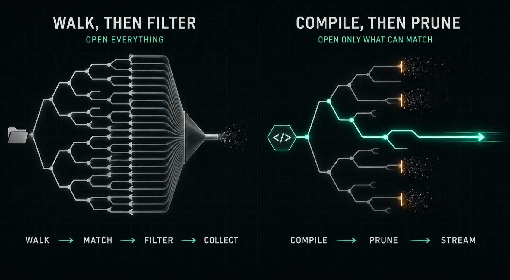

Branchcut is a filesystem query engine for people who need the right paths without paying for filesystem work that cannot contribute. It compiles patterns, exclusions, ignore policy, filters, metadata predicates, and termination into one plan.



## Start with the job you have

<Cards>
  <Card title="I just installed it" description="Install, search, prune, explain, and confirm your first result." href="/docs/tutorials/first-query" />
  <Card title="I need a project search" description="Narrow a monorepo root, exclude generated trees, and read the work counters." href="/docs/tutorials/monorepo" />
  <Card title="I am scripting or using an agent" description="Keep native paths intact with JSON Lines, NUL output, and shell-free commands." href="/docs/tutorials/automation" />
  <Card title="I am embedding the engine" description="Compile a reusable query and stream paths from a Rust application." href="/docs/tutorials/rust-library" />
</Cards>

## Who it is for

- **Everyday terminal users** who want a readable filename search without learning a pipeline of five tools.
- **Developers** who repeatedly select files across source, test, generated, and dependency directories.
- **Power users** who need exclusions, ignore policy, depth, metadata filters, exact limits, and machine-safe output.
- **Rust applications** that need a reusable traversal engine rather than a terminal wrapper.
- **Scripts and coding agents** that can call an ordinary executable and consume stable stdout, stderr, and exit behavior.

## Choose the next step

| You need | Start here |
|---|---|
| The complete command surface | [CLI reference](reference/cli) |
| A quick answer while editing shell syntax | [Cheat sheet](reference/cheatsheet) |
| The plumbing behind traversal and pruning | [Mental model](getting-started/mental-model) |
| Exact supported behavior and gaps | [Feature status](reference/feature-status) |
| Benchmark methods and raw evidence | [Benchmarks](evidence/benchmarks) |
| Current delivery priorities | [Roadmap](project/roadmap) |

## What makes Branchcut different

A conventional filesystem query often discovers too much and filters too late:

```text
walk everything -> glob -> ignore -> stat -> filter -> collect
```

Branchcut moves useful decisions ahead of traversal:

```text
compile positives + exclusions + ignore policy + predicates + limits
                                  |
                                  v
                    open only viable directories
```

The product claim is not universal speed superiority. It is narrower and testable: the whole query can avoid filesystem work before matching and filtering finish.

## What it does today

- Literal filename search and composed glob queries;
- shared positive patterns and subtree-pruning exclusions;
- type, extension, depth, size, modification-time, case, and hidden-path filters;
- opt-in root and nested `.gitignore` handling;
- streaming output, exact limits, optional sorting, JSON Lines, NUL output, and native paths;
- shell-free per-match and bounded batch command execution;
- `--explain`, `--why`, and real `--stats` counters;
- sequential and bounded parallel traversal;
- a zero-third-party-crate Rust library and thin CLI.

## What it does not do

Branchcut does not search file contents, build an index, watch a tree, provide a GUI/TUI, or claim full compatibility with every glob API. Content search belongs to a tool such as ripgrep. Branchcut can select the paths that another tool then reads or processes.

## Current status

The post-competition development tree is modular. Windows verification passes locally; Linux and macOS confirmation remains an explicit CI gate. Performance records are tied to their datasets and environments and are not universal rankings. See [Feature status](reference/feature-status), [Compatibility](reference/compatibility), and [Roadmap](project/roadmap).